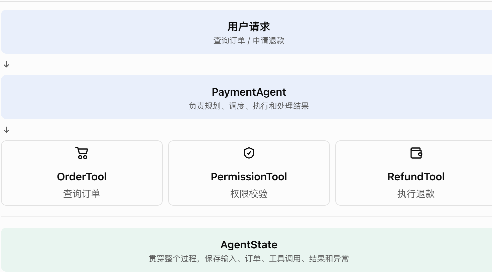
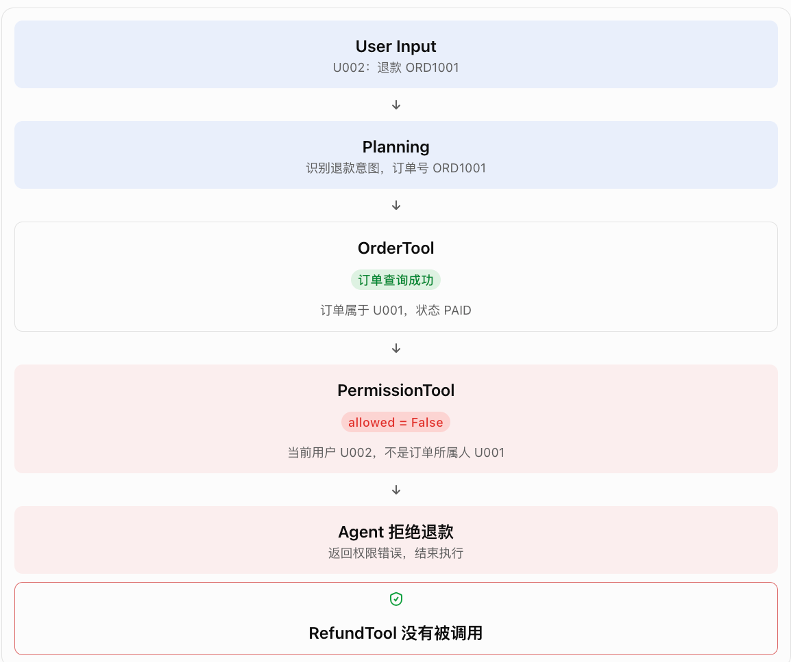

# Day 4：Agent 架构与运行机制

Day 1–3 已通过

Day 4 正式开始

W1 · Agent 基础

今天开始从 Prompt 测试正式进入 AI Agent 执行链路测试。

我会继续担任你的技术导师，按照之前 Day 1 的教学方式推进：先讲概念，再结合电商支付业务分析，然后设计代码任务，最后通过 Pytest 和严格代码评审验收。

先明确今天的教学原则：

不是为了让代码运行通过而写测试，而是要让测试能够发现 Agent 的真实缺陷。

## 一、承接前三天的学习进度

根据你的学习档案：

| 学习日      | 主题                             | 成绩  |
| -------- | ------------------------------ | --- |
| Day 1    | LLM 基础与 API 测试                 | 88  |
| Day 2    | Token、Tokenizer、Context        | 89  |
| Day 3    | Prompt Engineering 与 Prompt 测试 | 80  |
| Day 3 补充 | 越权退款测试                         | 86  |
| Day 4    | Agent 架构与运行机制                  | 待验收 |

目前已经掌握：

- LLM Client、FakeModel、SpyModel。
- TokenCounter、ContextChecker。
- Prompt 静态规则测试。
- 参数化测试及业务风险分析。
- 退款权限、重复退款等安全规则。

今天不重复前三天的内容，而是把这些知识连接起来。

day01-03 档案.md

## 二、Day 4 学习目标

# 今天需要掌握的 6 项能力

1. 理解普通 LLM 调用与 Agent 的区别。
2. 理解 Planning、Tool Calling、Observation、Reflection。
3. 理解 Agent 执行链路和状态流转。
4. 设计 Agent Trace 数据结构。
5. 使用 Fake Tool、Spy Tool 模拟和监控工具调用。
6. 使用 Pytest 验证执行行为，并定位第一个异常节点。

今天的核心交付物：

实现一个不依赖 LangChain、LangGraph 的轻量级电商支付 Agent，理解 Agent 的基本运行机制，为后续引入 LangGraph 做准备。

## 三、知识点 1：普通 LLM 调用与 Agent 的区别

这是 Day 4 最重要的基础概念。

### 1.1 普通 LLM 调用

例如，用户问：

> 帮我查询订单 ORD1001 的支付状态。

传统 LLM Client 的执行过程：

User Input

帮我查询订单 ORD1001 的支付状态

LLM Client

LLM Response

模型生成文本回答

核心特点：

- 输入 Prompt。
- 调用模型。
- 获得模型输出。
- 不一定有工具调用。
- 不一定有状态管理。
- 不一定有多步骤执行。

### 1.2 Agent 执行

同样的问题，如果交给 Agent：

1\. User Input

查询订单 ORD1001

2\. Planning

判断需要查询订单

3\. Tool Calling

调用 query_order(order_id='ORD1001')

4\. Observation

获得订单状态：PAID

5\. Final Response

订单已支付

Agent 不仅生成回答，还可能自主决定下一步操作，并根据工具返回结果继续执行。

### 1.3 两者的核心区别

| 对比项  | 普通 LLM | Agent          |
| ---- | ------ | -------------- |
| 输入   | Prompt | 用户任务及上下文       |
| 输出   | 模型响应   | 最终结果或中间动作      |
| 工具调用 | 通常没有   | 可以有            |
| 执行步骤 | 通常一次   | 可以多次           |
| 状态管理 | 简单     | 通常需要           |
| 执行轨迹 | 请求/响应  | 多步骤执行轨迹        |
| 测试重点 | 输入输出   | 输入、决策、工具、状态、结果 |

导师强调：

Agent 并不是一个新的大模型，而是围绕模型构建的一套执行机制。

从测试角度看：

以前你测试的是：

```
response = llm_client.chat(prompt)assert response != ""
```

现在你还要测试：

```
result = agent.run(user_input)assert "query_order" in result.tool_callsassert result.order_status == "PAID"assert result.success is True
```

当然，第二段只是示意。后面我们会设计真正可验证的 Trace 和断言。

## 四、知识点 2：Agent 的四个核心执行环节

今天重点理解四个术语。

### 2.1 Planning：规划

Agent 根据用户需求决定下一步要做什么。

电商支付案例：

用户：

> 帮我查一下订单 ORD1001 有没有支付成功。

Agent 需要判断：

```
用户意图：查询订单支付状态

需要执行：
1. 查询订单
2. 读取支付状态
3. 返回查询结果
```

测试关注点：

- 是否识别正确意图？
- 是否选择正确工具？
- 是否提取正确订单号？
- 是否制定了不必要的操作？

### 2.2 Tool Calling：工具调用

Agent 选择工具并传递参数。

例如：

```
query_order(order_id="ORD1001")
```

测试不能只判断工具有没有被调用，还需要验证：

```
assert tool_call.name == "query_order"assert tool_call.arguments == {    "order_id": "ORD1001"}
```

如果订单号被错误解析成 `ORD1002`，即使工具正常返回，Agent 仍然存在严重缺陷。

### 2.3 Observation：观察

工具返回执行结果，Agent 根据结果继续决策。

例如：

```
{    "order_id": "ORD1001",    "payment_status": "PAID",    "amount": 199.00}
```

测试关注点：

- Agent 是否正确接收工具返回？
- 是否使用了真实工具结果？
- 是否忽略了工具错误？
- 是否出现结果与回答不一致？

特别注意：

如果工具返回：

```
{"payment_status": "UNPAID"}
```

Agent 却回答：

```
订单已经支付成功。
```

这是典型的 Observation 处理缺陷。

### 2.4 Reflection：反思与调整

Agent 根据执行结果判断是否需要调整下一步行为。

例如：

```
第一次查询订单
      ↓
工具返回：订单不存在
      ↓
判断：当前任务无法继续
      ↓
停止执行
      ↓
告知用户订单不存在
```

注意：Reflection 并不是每个 Agent 都必须实现一个独立的反思模块。它也可能体现在模型下一轮决策中。

测试重点：

- 工具失败后是否正确处理？
- 是否无限重试？
- 是否重复调用相同工具？
- 是否在失败后仍然声称成功？
- 是否正确终止执行？

### 2.5 四个环节的测试映射

| 环节           | 测试对象 | 关键断言       |
| ------------ | ---- | ---------- |
| Planning     | 决策   | 是否选择正确工具   |
| Tool Calling | 工具调用 | 名称、参数、调用次数 |
| Observation  | 工具结果 | 是否正确处理返回   |
| Reflection   | 后续决策 | 是否继续、重试或终止 |

这张表建议保留，后续学习 Tool Calling、Workflow、Multi-Agent 时会反复使用。

## 五、知识点 3：Agent Trace 设计

今天的重点技术知识

这是传统自动化测试工程师转向 Agent 测试时需要重点建立的能力。

### 5.1 为什么需要 Trace？

假设 Agent 最终回答：

```
订单 ORD1001 已支付成功。
```

但实际情况是：

```
订单 ORD1001 尚未支付。
```

如果只看最终回答，我们知道结果错误，却不知道问题在哪里。

可能的原因：

1. Planning 选择了错误的工具。
2. Tool Calling 传递了错误订单号。
3. 工具返回的数据错误。
4. Observation 没有正确处理工具结果。
5. Final Response 没有依据工具结果生成。

我们需要一条完整的执行轨迹。

### 5.2 设计 Trace 数据结构

今天先采用简单的 JSON 结构：

```
{    "trace_id": "TRACE001",    "user_input": "查询订单 ORD1001",    "steps": [        {            "step": 1,            "type": "planning",            "action": "query_order"        },        {            "step": 2,            "type": "tool_call",            "tool_name": "query_order",            "arguments": {                "order_id": "ORD1001"            }        },        {            "step": 3,            "type": "observation",            "result": {                "payment_status": "PAID"            }        },        {            "step": 4,            "type": "final_response",            "content": "订单已支付"        }    ],    "status": "success"}
```

### 5.3 Trace 在测试中的作用

例如：

```
trace = agent.run("查询订单 ORD1001")assert trace.steps[0]["type"] == "planning"assert trace.steps[1]["tool_name"] == "query_order"assert trace.steps[1]["arguments"]["order_id"] == "ORD1001"assert trace.steps[2]["result"]["payment_status"] == "PAID"
```

这样就可以验证 Agent 的执行过程，而不只是验证最后的自然语言回答。

导师要求：

今天设计的 Trace 必须支持：

- 记录每一步的执行顺序。
- 记录工具名称。
- 记录工具参数。
- 记录工具返回结果。
- 记录执行状态。
- 记录异常信息。

后续还会逐步增加耗时、Token、模型信息和父子 Span。

## 六、知识点 4：Fake Tool、Spy Tool 与 Mock

这部分直接关联你之前学过的 FakeModel、SpyModel。

先区分三个概念：

| 类型        | 主要用途      | 今天的应用     |
| --------- | --------- | --------- |
| Fake Tool | 提供可控的模拟行为 | 模拟查询订单、退款 |
| Spy Tool  | 记录调用行为    | 验证调用次数和参数 |
| Mock Tool | 控制依赖行为及预期 | 模拟工具异常    |

例如，我们定义一个 SpyTool：

```
class SpyTool:    def __init__(self, tool):        self.tool = tool        self.calls = []    def __call__(self, **kwargs):        self.calls.append(kwargs)        return self.tool(**kwargs)
```

调用：

```
spy = SpyTool(query_order)result = spy(order_id="ORD1001")
```

检查：

```
assert len(spy.calls) == 1assert spy.calls[0] == {    "order_id": "ORD1001"}
```

这和你 Day 1 的 SpyModel 思路一致，只不过今天的被观察对象从 LLM Client 扩展到了 Agent Tool。

## 七、Day 4 实战：电商支付 Agent

核心编码任务

今天不直接上 LangGraph，也不接真实 LLM API。

我们先自己实现一个最小 Agent 执行框架，确保你理解底层机制。

### 7.1 业务背景

假设电商平台有以下订单：

| 订单号     | 用户ID | 金额  | 支付状态   | 退款状态         |
| ------- | ---- | --- | ------ | ------------ |
| ORD1001 | U001 | 199 | PAID   | NOT_REFUNDED |
| ORD1002 | U002 | 299 | UNPAID | NOT_REFUNDED |
| ORD1003 | U001 | 399 | PAID   | REFUNDED     |
| ORD1004 | U003 | 599 | PAID   | NOT_REFUNDED |

Agent 支持：

1. 查询订单。
2. 查询支付状态。
3. 查询退款资格。
4. 验证用户权限。
5. 执行退款（后半阶段实现）。

今天分两个阶段完成。

- 第一阶段：实现订单查询 Agent。
- 第二阶段：扩展退款流程和安全测试。

### 7.2 项目目录

在你现有项目中新增以下文件：

```
ai-agent-testing/
│
├── src/
│   ├── llm/
│   ├── utils/
│   │
│   ├── agent/
│   │   ├── __init__.py
│   │   ├── agent.py
│   │   └── state.py
│   │
│   └── tools/
│       ├── __init__.py
│       ├── order_tool.py
│       ├── permission_tool.py
│       └── refund_tool.py
│
├── tests/
│   └── week01/
│       ├── test_prompt_rules.py
│       └── test_agent_execution.py
│
└── docs/
    └── day04_agent_architecture.md
```

不需要修改 Day 1～Day 3 的已有代码。

### 7.3 第一阶段：实现 AgentState

文件：

`src/agent/state.py`

任务：

设计 Agent 的状态对象。

至少需要支持：

| 字段             | 类型建议        | 含义     |
| -------------- | ----------- | ------ |
| user_id        | str         | 当前用户   |
| user_input     | str         | 用户输入   |
| order_id       | str 或 None  | 订单号    |
| order_data     | dict 或 None | 订单数据   |
| tool_calls     | list        | 工具调用记录 |
| final_response | str 或 None  | 最终回答   |
| status         | str         | 执行状态   |
| error          | str 或 None  | 异常信息   |

要求：

1. 使用 Python `dataclass`。
2. 字段必须有明确类型。
3. 合理设置默认值。
4. 不同 Agent 运行之间不能共享可变状态。
5. 状态对象要便于后续扩展。

思考题：

为什么不能直接使用一个全局 dict 保存所有 Agent 状态？

### 7.4 第二阶段：实现订单查询工具

文件：

`src/tools/order_tool.py`

实现：

```
def query_order(order_id: str) -> dict:    ...
```

要求：

- ORD1001 返回对应订单数据。
- ORD1002 返回对应订单数据。
- ORD1003 返回对应订单数据。
- ORD1004 返回对应订单数据。
- 不存在的订单返回明确错误结果。
- 不允许返回不存在订单的虚构数据。

订单数据先写在 Python 内存中，不需要连接数据库。

### 7.5 第三阶段：实现 Agent

文件：

`src/agent/agent.py`

定义：

```
class PaymentAgent:    def __init__(self, tools):        ...    def run(self, user_id: str, user_input: str):        ...
```

第一阶段只实现订单查询。

基本执行过程：

```
用户输入
   ↓
识别查询订单意图
   ↓
提取订单号
   ↓
Planning
   ↓
选择 query_order
   ↓
Tool Calling
   ↓
执行订单查询
   ↓
Observation
   ↓
根据工具结果生成回答
   ↓
返回 AgentState 和 Trace
```

注意：

今天为了可控性，Planning 暂时使用确定性的规则模拟，不需要真实 LLM。

例如：

```
user_input = "帮我查询订单 ORD1001 的支付状态"
```

提取订单号：

```
ORD1001
```

选择工具：

```
query_order
```

这是一种教学用的 Agent 执行器，不代表已经实现了真正的模型自主规划。后续接入 LLM 后，我们再测试模型是否能正确选择工具。

### 7.6 第四阶段：实现 Trace

在 Agent 执行过程中记录每一步。

至少支持：

```
{    "step": 1,    "type": "planning",    "action": "query_order"}
```

```
{    "step": 2,    "type": "tool_call",    "tool_name": "query_order",    "arguments": {        "order_id": "ORD1001"    }}
```

```
{    "step": 3,    "type": "observation",    "result": {        "order_id": "ORD1001",        "payment_status": "PAID"    }}
```

Trace 应当反映实际发生的事情，不能为了让测试通过而预先伪造执行记录。

## 八、Day 4 Pytest 测试任务

今天最重要的验收部分

不要急着写代码，先理解下面的测试场景。

### 8.1 第一组：Agent 基础功能测试

| ID   | 测试场景       | 预期结果        |
| ---- | ---------- | ----------- |
| TC01 | 查询 ORD1001 | 返回 PAID     |
| TC02 | 查询 ORD1002 | 返回 UNPAID   |
| TC03 | 查询 ORD1003 | 返回 REFUNDED |
| TC04 | 查询不存在订单    | 返回明确错误      |
| TC05 | 用户输入不包含订单号 | 不调用订单查询工具   |

### 8.2 第二组：Tool Calling 测试

这是今天的重点。

| ID   | 测试场景       | 预期结果                 |
| ---- | ---------- | -------------------- |
| TC06 | 查询 ORD1001 | 调用 query_order 一次    |
| TC07 | 查询 ORD1001 | 参数必须是 ORD1001        |
| TC08 | 查询 ORD1001 | 不允许调用 execute_refund |
| TC09 | 查询 ORD1001 | 工具调用顺序正确             |
| TC10 | 查询不存在订单    | 不能生成虚构订单数据           |

特别注意 TC08：

用户只是查询订单，Agent 不应该执行退款。

```
assert "execute_refund" not in tool_names
```

这与你 Day 3 的越权退款测试思维是一致的：不仅验证应该发生什么，还要验证不应该发生什么。

### 8.3 第三组：Observation 测试

| ID   | 测试场景          | 预期结果           |
| ---- | ------------- | -------------- |
| TC11 | 工具返回 PAID     | Agent 回答已支付    |
| TC12 | 工具返回 UNPAID   | Agent 回答未支付    |
| TC13 | 工具返回 REFUNDED | Agent 回答已退款    |
| TC14 | 工具返回异常        | Agent 不能声称查询成功 |

这里需要特别关注：

Agent 的最终回答必须依据工具实际返回的数据，而不是依据用户输入或者预设的回答。

### 8.4 第四组：Trace 测试

| ID   | 测试场景 | 预期结果                 |
| ---- | ---- | -------------------- |
| TC15 | 正常查询 | Trace 包含 planning    |
| TC16 | 正常查询 | Trace 包含 tool_call   |
| TC17 | 正常查询 | Trace 包含 observation |
| TC18 | 正常查询 | Step 顺序正确            |
| TC19 | 工具异常 | Trace 记录异常节点         |
| TC20 | 执行完成 | Trace 状态与实际结果一致      |

### 8.5 第五组：Agent 状态隔离

| ID   | 测试场景          | 预期结果         |
| ---- | ------------- | ------------ |
| TC21 | 连续运行两个不同用户    | 用户状态不能串扰     |
| TC22 | 第二次查询不同订单     | 不能沿用第一次订单号   |
| TC23 | 第一次运行失败，第二次成功 | 第二次不能继承第一次错误 |
| TC24 | 连续运行多次        | Trace 独立     |

这组测试非常重要。

在传统接口测试中，我们容易关注单次请求；但 Agent 往往有多轮交互和状态管理问题。

## 九、严格代码评审：导师会重点检查什么？

我不会只看 24 个测试是否通过。

今天评分采用 100 分制：

| 评审维度             | 分值  |
| ---------------- | --- |
| Agent 架构与职责划分    | 15  |
| AgentState 设计    | 10  |
| Tool Calling 实现  | 15  |
| Trace 设计         | 15  |
| Pytest 场景覆盖      | 20  |
| Mock、Fake、Spy 使用 | 10  |
| 异常及边界处理          | 10  |
| 代码规范与可扩展性        | 5   |
| 总分               | 100 |

### 以下问题会被重点扣分

1. 直接在 Agent 内部硬编码订单查询逻辑，导致无法独立替换工具。
2. Agent 没有记录真实工具调用过程。
3. 只验证最终回答，不验证 Tool Calling。
4. 测试没有检查工具参数。
5. 测试没有检查不应该调用的工具。
6. 工具发生异常，Agent 仍然回答成功。
7. 不同用户运行时共享状态。
8. 测试依赖真实 LLM，导致结果不稳定。
9. 测试全部通过，但无法发现人为注入的缺陷。

验收规则：

- 90 分及以上：优秀，通过。
- 80～89 分：通过，但需要记录改进项。
- 70～79 分：限期修改后复评。
- 70 分以下：未通过，重新完成核心任务。

另外，涉及退款安全的关键测试如果存在缺陷，即使总分达到 80 分，也不能直接进入下一天。

## 十、Day 4 学习安排（建议 6～8 小时）

考虑到今天的内容有一定架构设计难度，我建议按以下节奏执行。

| 阶段 | 学习内容                      | 建议时间   |
| -- | ------------------------- | ------ |
| 1  | LLM 与 Agent 区别            | 40 分钟  |
| 2  | Planning、Tool Calling 等概念 | 60 分钟  |
| 3  | AgentState、Trace 设计       | 60 分钟  |
| 4  | Fake Tool、Spy Tool 实现     | 60 分钟  |
| 5  | PaymentAgent 编码           | 120 分钟 |
| 6  | Pytest 测试设计与执行            | 90 分钟  |
| 7  | 总结和提交                     | 30 分钟  |

### 最终需要提交的作业

Day 4 提交清单

0/9

src/agent/state.py

src/agent/agent.py

src/tools/order_tool.py

src/tools/permission_tool.py（如已实现）

src/tools/refund_tool.py（如已实现）

tests/week01/test_agent_execution.py

docs/day04_agent_architecture.md

完整 pytest 执行结果

Day 4 思考题答案

### 十一、Day 4 思考题

请在编码前后分别回答这些问题：

Q1. 为什么 Agent 测试不能只验证最终回答？

Q2. 如果工具调用成功，但是 Observation 阶段读取了错误的返回数据，应该如何定位？

Q3. Fake Tool 和 Spy Tool 有什么区别？什么时候应该使用它们？

Q4. 为什么每次 Agent.run() 都应该有独立的状态和 Trace？

Q5. 如果用户要求查询订单，但 Agent 调用了退款工具，你会设计哪些断言来发现这个问题？

## 十二、关于你的 GitHub 学习资料

你提供了三个项目入口：

- [docs 学习文档](https://github.com/chunrong50/ai-agent-testing/tree/main/docs?utm_source=chatgpt.com)
- [src 项目源码](https://github.com/chunrong50/ai-agent-testing/tree/main/src?utm_source=chatgpt.com)
- [tests/week01 测试代码](https://github.com/chunrong50/ai-agent-testing/tree/main/tests/week01?utm_source=chatgpt.com)

本次会话中 GitHub 目录页面没有成功加载，因此我没有把仓库中尚未读取的代码或 Day 1 文档内容当作已核实的事实。

本次 Day 4 的课程设计依据你上传的 Day 1～Day 3 学习档案，沿用其中明确规定的目标、代码结构和验收方式。

day01-03 档案.md


如果你希望我严格对照仓库里的 Day 1 模板逐项复刻教学格式，可以把 `docs` 和相关源码打包上传，我会进一步对齐。

## 导师的第一项要求

今天先不要急着实现退款功能。

优先完成 AgentState、query_order 和 PaymentAgent 的订单查询闭环。

我们先确保你真正理解 Agent 是如何执行任务的，再扩展退款、权限校验和安全测试。

你完成第一阶段后，把代码和 pytest 结果发给我。我会按照高级测试开发工程师的标准进行逐文件、逐测试用例评审，不会因为测试通过就轻易给出高分。

Day 4 正式开始。今天的目标不是写出一个能聊天的 Agent，而是写出一个能够被测试、被追踪、被验证的 Agent。

## 具体的类不太理解，再一次咨询
可以。我们今天先暂停复杂的 Pytest 测试，专门把 Agent 最小执行框架的底层机制 搞清楚。

你现在不理解底层机制是正常的，因为 Day 1～Day 3 学习的是 LLM、Token、Prompt，今天第一次把这些知识组合成一个具有执行能力的 Agent。

我不会直接给你一堆复杂代码让你照抄，而是按照一个高级测试开发工程师应该理解的方式，逐个解释类的职责、调用关系和完整执行过程。

今天我们实现 5 个文件：

| 文件                   | 职责                |
| -------------------- | ----------------- |
| `state.py`           | 保存 Agent 执行过程中的状态 |
| `agent.py`           | 控制 Agent 的执行流程    |
| `order_tool.py`      | 查询订单              |
| `permission_tool.py` | 验证用户权限            |
| `refund_tool.py`     | 执行退款              |

先统一一下文件名：你写的 `order_too.py`、`premission_tool.py`，建议分别使用 `order_tool.py`、`permission_tool.py`。

## 一、先理解：Agent 到底是什么？

先看一个真实业务问题：

用户说：

> 帮我查询一下订单 ORD1001 的支付状态。

一个最小 Agent 可以理解为一个任务执行器：

1. 接收用户请求。
2. 判断用户想做什么。
3. 决定使用哪个工具。
4. 调用工具。
5. 获取工具返回结果。
6. 根据结果生成回答。
7. 保存整个执行过程。

注意：这里的 Agent 并不等于 LLM。

今天我们先不接入大模型，用 Python 规则模拟 Planning。这样可以把 Agent 的执行机制单独研究清楚。

### 1.1 五个类之间的关系


用户请求

查询订单 / 申请退款

PaymentAgent

负责规划、调度、执行和处理结果

OrderTool

查询订单

PermissionTool

权限校验

RefundTool

执行退款

AgentState

这里有一个很重要的设计原则：

- Agent 决定什么时候调用工具。
- Tool 负责具体业务操作。
- State 负责保存执行状态。

不要把所有业务逻辑都写进 Agent。

## 二、先建立项目结构

按照你现有的项目结构，在 `src` 下创建：

```
src/
├── agent/
│   ├── __init__.py
│   ├── state.py
│   └── agent.py
│
└── tools/
    ├── __init__.py
    ├── order_tool.py
    ├── permission_tool.py
    └── refund_tool.py
```

今天先不引入任何第三方 Agent 框架。

我们使用：

- Python `dataclass`：管理状态。
- Python `re`：识别订单号。
- Python 类：封装工具。
- Python 字典：模拟订单数据库。
- Pytest：后续验证执行链路。

下面代码按 Python 3.10+ 编写。

## 三、实现第一个类：AgentState

文件：`src/agent/state.py`

### 3.1 先理解为什么需要 State

假设用户发起退款：

```
用户：帮我退掉订单 ORD1001
```

Agent 执行过程中，需要记住：

```
当前用户：U001
当前订单：ORD1001
订单金额：199
支付状态：PAID
用户是否有权限：True
退款是否成功：True
最终回答：退款成功
```

这些数据不能全部依赖局部变量，也不能依赖全局变量。

因此，我们需要一个专门的对象保存一次 Agent 运行过程中的数据。

### 3.2 完整代码

```
# src/agent/state.pyfrom dataclasses import dataclass, fieldfrom typing import Any, Optional@dataclassclass AgentState:    """保存一次 Agent 执行过程中的状态。"""    user_id: str    user_input: str    order_id: Optional[str] = None    order_data: Optional[dict[str, Any]] = None    # 记录实际发生的工具调用    tool_calls: list[dict[str, Any]] = field(default_factory=list)    # 记录完整执行轨迹    trace: list[dict[str, Any]] = field(default_factory=list)    final_response: Optional[str] = None    # running / success / failed    status: str = "running"    error: Optional[str] = None    def add_tool_call(        self,        tool_name: str,        arguments: dict[str, Any]    ) -> None:        """记录一次工具调用。"""        self.tool_calls.append({            "tool_name": tool_name,            "arguments": arguments.copy()        })    def add_trace(        self,        step_type: str,        **details: Any    ) -> None:        """记录一次执行轨迹。"""        self.trace.append({            "step": len(self.trace) + 1,            "type": step_type,            **details        })
```

### 3.3 重点解释

知识点 A：为什么使用 dataclass？

普通写法：

```
class AgentState:    def __init__(self, user_id, user_input):        self.user_id = user_id        self.user_input = user_input
```

使用 dataclass：

```
@dataclassclass AgentState:    user_id: str    user_input: str
```

Python 自动帮我们生成初始化方法等基础功能。

知识点 B：为什么使用 field(default_factory=list)？

这是一个很重要的 Python 测试知识点。

不要这样写：

```
tool_calls: list = []
```

因为多个对象可能共享同一个可变列表。

正确写法：

```
tool_calls: list = field(default_factory=list)
```

每次创建 AgentState，都会创建一个新的列表。

知识点 C：为什么要有 trace 和 tool_calls 两个字段？

两者目的不同：

| 字段         | 用途                                                |
| ---------- | ------------------------------------------------- |
| tool_calls | 记录实际调用了什么工具、传了什么参数                                |
| trace      | 记录完整执行过程，包括 Planning、Tool Calling、Observation、异常等 |

后面我们会利用这两个字段设计测试断言。

## 四、实现第二个类：OrderTool

文件：`src/tools/order_tool.py`

### 4.1 OrderTool 的职责

OrderTool 只负责查询订单。

它不负责：

- 判断用户是否有退款权限。
- 判断是否应该退款。
- 执行退款。
- 生成 Agent 的最终回答。

这些职责应该由其他组件承担。

### 4.2 完整代码

```
# src/tools/order_tool.pyfrom copy import deepcopyfrom typing import OptionalDEFAULT_ORDERS = {    "ORD1001": {        "order_id": "ORD1001",        "user_id": "U001",        "amount": 199.00,        "payment_status": "PAID",        "refund_status": "NOT_REFUNDED"    },    "ORD1002": {        "order_id": "ORD1002",        "user_id": "U002",        "amount": 299.00,        "payment_status": "UNPAID",        "refund_status": "NOT_REFUNDED"    },    "ORD1003": {        "order_id": "ORD1003",        "user_id": "U001",        "amount": 399.00,        "payment_status": "PAID",        "refund_status": "REFUNDED"    },    "ORD1004": {        "order_id": "ORD1004",        "user_id": "U003",        "amount": 599.00,        "payment_status": "PAID",        "refund_status": "NOT_REFUNDED"    }
```

### 4.3 这里有一个重要设计

为什么使用：

```
deepcopy(order)
```

而不是：

```
return order
```

因为如果直接返回原始字典：

```
result = order_tool.query_order("ORD1001")result["data"]["payment_status"] = "UNPAID"
```

可能会直接修改订单数据库中的数据。

这会导致测试之间互相污染。

这是自动化测试中非常典型的数据隔离问题。

## 五、实现第三个类：PermissionTool

文件：`src/tools/permission_tool.py`

### 5.1 为什么需要独立的权限工具？

考虑下面的情况：

用户 U001：

```
帮我退掉订单 ORD1004
```

但是：

```
ORD1004 属于 U003
```

即使订单已经支付成功，也不能允许 U001 退款。

因此，退款之前必须进行权限验证。

这里需要区分：

- OrderTool：订单是否存在？
- PermissionTool：当前用户是否有权限操作订单？

这是两个不同的业务问题。

### 5.2 完整代码

```
# src/tools/permission_tool.pyclass PermissionTool:    """用户订单操作权限校验工具。"""    def check_permission(        self,        user_id: str,        order: dict    ) -> dict:        """验证用户是否有权操作指定订单。"""        if not isinstance(user_id, str) or not user_id.strip():            return {                "success": False,                "allowed": False,                "error": "用户ID不能为空"            }        if not isinstance(order, dict):            return {                "success": False,                "allowed": False,                "error": "订单数据无效"            }        order_user_id = order.get("user_id")        if not order_user_id:            return {                "success": False,                "allowed": False,                "error": "订单缺少所属用户信息"            }
```

### 5.3 运行效果

```
permission_tool = PermissionTool()order = {    "order_id": "ORD1004",    "user_id": "U003"}result = permission_tool.check_permission(    user_id="U001",    order=order)print(result)
```

预期：

```
{    "success": True,    "allowed": False,    "user_id": "U001",    "order_user_id": "U003",    "reason": "用户无权操作该订单"}
```

注意：

`success=True` 和 `allowed=False` 并不矛盾。

前者表示权限校验工具正常执行，后者表示用户没有权限。

这是后续测试中非常重要的一个区别。

## 六、实现第四个类：RefundTool

文件：`src/tools/refund_tool.py`

### 6.1 RefundTool 的职责

RefundTool 真正执行退款。

这里有一个非常重要的架构原则：

不能因为 Agent 判断可以退款，就直接认为退款一定安全。

退款工具本身还必须执行服务端业务校验。

例如：

| 校验项        | 要求               |
| ---------- | ---------------- |
| 订单是否存在     | 必须存在             |
| 用户是否为订单所属人 | 必须一致             |
| 支付状态       | 必须是 PAID         |
| 退款状态       | 必须是 NOT_REFUNDED |
| 重复退款       | 必须拒绝             |

这样即使 Agent 漏掉了权限检查，底层退款服务也不能直接执行越权退款。

### 6.2 完整代码

```
# src/tools/refund_tool.pyfrom typing import Anyclass RefundTool:    """模拟退款执行工具。"""    def __init__(self, orders: dict[str, dict[str, Any]]):        # 与 OrderTool 使用同一份订单数据        self.orders = orders    def execute_refund(        self,        user_id: str,        order_id: str    ) -> dict:        """执行退款，并进行服务端业务校验。"""        order = self.orders.get(order_id)        # 1. 检查订单是否存在        if order is None:            return {                "success": False,                "error": "订单不存在"            }        # 2. 再次检查订单所属人        if order.get("user_id") != user_id:            return {                "success": False,                "error": "无权退款：订单不属于当前用户"            }
```

### 6.3 这里有一个特别重要的设计：共享订单数据

注意这两行：

```
order_tool = OrderTool()refund_tool = RefundTool(    orders=order_tool.orders)
```

为什么要这样写？

因为：

- OrderTool 查询订单。
- RefundTool 修改订单退款状态。

它们必须操作同一份订单数据。

如果两个工具分别创建独立的订单字典：

```
order_tool = OrderTool()refund_tool = RefundTool(    orders=another_orders)
```

就可能出现：

```
RefundTool：退款成功
OrderTool：订单仍然显示未退款
```

这就是一个典型的数据一致性问题。

今天我们使用共享字典模拟数据库，后续可以把它替换成 Repository 或数据库服务。

## 七、实现第五个类：PaymentAgent

核心执行引擎

文件：`src/agent/agent.py`

这是今天最重要的一个类。

前面四个类都只是提供基础能力。

真正让它们协同工作的，是 PaymentAgent。

### 7.1 先理解 Agent 的执行流程

我们先看两个场景。

场景 A：查询订单

```
用户：查询 ORD1001
        ↓
Agent：Planning
        ↓
Agent：选择 query_order
        ↓
Agent：调用 OrderTool
        ↓
OrderTool：返回订单数据
        ↓
Agent：Observation
        ↓
Agent：生成最终回答
```

场景 B：申请退款

```
用户：退款 ORD1001
        ↓
Agent：Planning
        ↓
Agent：查询订单
        ↓
OrderTool：返回订单数据
        ↓
Agent：检查用户权限
        ↓
PermissionTool：返回 allowed=True
        ↓
Agent：调用退款工具
        ↓
RefundTool：再次执行服务端校验
        ↓
Agent：生成最终回答
```

你要特别注意：

Agent 不只是简单地调用工具。

它负责决定工具调用的先后顺序，并根据每个工具的返回结果决定下一步。

### 7.2 完整代码

```
# src/agent/agent.pyimport refrom typing import Anyfrom src.agent.state import AgentStateclass PaymentAgent:    """最小电商支付 Agent 执行框架。"""    def __init__(self, tools: dict[str, Any]):        self.tools = tools    def _extract_order_id(        self,        user_input: str    ) -> str | None:        """从用户输入中提取订单号。"""        match = re.search(            r"ORD\d+",            user_input,            re.IGNORECASE        )        return match.group(0).upper() if match else None    def _record_tool_call(        self,        state: AgentState,        tool_name: str,        arguments: dict    ) -> None:        """记录真实工具调用信息。"""
```

## 八、把五个类连接起来：创建 PaymentAgent

到这里，五个文件已经实现，但它们还没有真正协作。

我们需要创建工具实例，并注入 Agent。

### 8.1 依赖关系初始化

可以先在项目根目录的 `main.py` 中写：

```
# main.pyfrom src.agent.agent import PaymentAgentfrom src.tools.order_tool import OrderToolfrom src.tools.permission_tool import PermissionToolfrom src.tools.refund_tool import RefundTool# 1. 创建订单工具order_tool = OrderTool()# 2. 创建权限工具permission_tool = PermissionTool()# 3. 创建退款工具# 注意：和 OrderTool 共用同一份订单数据refund_tool = RefundTool(    orders=order_tool.orders)# 4. 将工具注册给 Agenttools = {    "order": order_tool,    "permission": permission_tool,    "refund": refund_tool}# 5. 创建 Agentagent = PaymentAgent(tools=tools)# 6. 测试订单查询result = agent.run(    user_id="U001",    user_input="帮我查询订单 ORD1001 的支付状态"
```

运行：

```
python main.py
```

### 8.2 你应该看到什么结果？

第一次查询：

```
最终回答：
订单 ORD1001 查询成功，
支付状态：PAID，
退款状态：NOT_REFUNDED

执行状态：success
```

第二次退款：

```
退款结果：
订单 ORD1001 退款成功，退款金额：199.00

执行状态：success
```

如果再次退款：

```
退款失败：订单已经退款，不能重复退款

执行状态：failed
```

如果 U002 尝试退款 ORD1001：

```
退款失败：用户无权操作该订单

执行状态：failed
```

### 8.3 完整执行链路示意

以 U002 越权退款 ORD1001 为例：


这就是 Agent 测试最值得关注的地方：

```
assert "execute_refund" not in tool_names
```

不是只验证最后回答说了退款失败，而是要验证退款工具根本没有被调用。

## 九、运行前需要理解的两个重要限制

这份代码是教学用的最小 Agent 框架，还不是生产级支付 Agent。

限制 1：Planning 是规则模拟，不是真正的 LLM Planning。

例如：

```
is_refund = any(    keyword in user_input    for keyword in ["退款", "退掉", "退还"])
```

这种方法可能把：

```
查询 ORD1001 的退款状态
```

错误识别成退款操作。

建议把 Agent 中这段判断替换为：

```
def _is_refund_request(self, user_input: str) -> bool:    explicit_refund_phrases = [        "申请退款",        "我要退款",        "帮我退款",        "帮我退",        "退掉",        "退还",        "执行退款"    ]    return any(        phrase in user_input        for phrase in explicit_refund_phrases    )
```

然后在 `run()` 中：

```
is_refund = self._is_refund_request(user_input)
```

这只是一个教学阶段的规则识别器，不能替代生产环境的意图识别。

限制 2：内存字典不能保证生产环境的退款幂等性。

真实支付系统需要在服务端使用数据库事务、幂等键、并发控制等机制，避免两个并发请求同时退款。

目前的 RefundTool 只模拟了基本业务校验。

## 十、从测试开发角度，理解 Agent 的底层机制

现在我们回头看一下今天最重要的三个问题。

### 10.1 Agent 为什么需要 State？

因为 Agent 执行不是一个简单函数调用，而是一系列连续动作。

State 就像一次业务流程的上下文容器。

例如：

```
state = AgentState(    user_id="U001",    user_input="退款 ORD1001")
```

在执行过程中：

```
state.order_id = "ORD1001"state.order_data = {    "order_id": "ORD1001",    "payment_status": "PAID"}
```

权限校验、退款执行、最终回答都可以使用同一个 State。

每次 `agent.run()` 都会创建新的 State，避免不同请求之间的数据串扰。

### 10.2 Agent 为什么需要 Tools？

因为 LLM 或 Agent 本身并不天然拥有订单数据库、支付系统和退款系统的访问能力。

Tool 是 Agent 与外部业务能力交互的接口。

未来接入真实 LLM 后，整体模式会变成：

```
LLM 判断：
我要查询订单

       ↓

Agent 接收模型的工具调用请求

       ↓

Python 执行 OrderTool

       ↓

将工具结果返回给 LLM

       ↓

LLM 根据结果决定下一步
```

今天我们用规则代替 LLM 的决策部分，但工具执行机制是一致的。

### 10.3 Trace 为什么对 Agent 测试这么重要？

因为 Trace 能告诉我们 Agent 每一步实际做了什么。

例如：

```
for item in result.trace:    print(item)
```

可能得到：

```
1. planning
2. tool_call: query_order
3. observation: query_order
4. tool_call: check_permission
5. observation: check_permission
6. tool_call: execute_refund
7. observation: execute_refund
8. final_response
```

这就是后续 Agent 自动化测试、执行链路分析和问题定位的基础。

## 十一、今天先做一个小练习

在正式进入完整 Pytest 作业前，我希望你先确认自己真正理解了执行机制。

Day 4 底层机制理解测试

4 道题

Q1. AgentState 的主要职责是什么？

负责调用 LLM

保存一次 Agent 执行过程中的数据

负责执行退款

负责查询数据库

Q2. 用户 U002 退款 ORD1001，但订单属于 U001，正确执行链路是什么？

直接调用 RefundTool，再返回失败

查询订单 → 权限校验 → 拒绝退款，不调用 RefundTool

直接返回退款成功

只调用 PermissionTool，不查询订单

Q3. 为什么 OrderTool 和 RefundTool 要共享同一份订单数据？

为了减少代码行数

为了保证退款修改的数据能被订单查询读取

为了让 Agent 自动调用 LLM

为了共享 Trace

Q4. 如果 PermissionTool 返回 allowed=False，应该验证什么？

只验证最终回答

验证退款失败，并断言 execute_refund 没有被调用

验证退款工具返回成功

验证订单查询没有发生

提交答案

## 十二、今天的编码顺序和验收要求

我建议你不要一次性把五个文件全部写完。

按照下面顺序操作：

1. 先完成 `state.py`，自己创建两个 State，验证数据是否隔离。
2. 完成 `order_tool.py`，单独测试订单查询。
3. 完成 `permission_tool.py`，测试有权限和无权限。
4. 完成 `refund_tool.py`，测试正常退款、未支付退款、重复退款和越权退款。
5. 最后完成 `agent.py`，把前面四个组件串起来。

今天第一阶段验收标准：

- 可以查询订单。
- 可以申请退款。
- 无权限时不调用退款工具。
- 未支付订单不能退款。
- 已退款订单不能重复退款。
- 每次执行有独立 State。
- Trace 能反映真实执行顺序。
- 工具异常不能被伪装成执行成功。

完成后再编写 `tests/week01/test_agent_execution.py`，我们逐项评审。

导师最后强调一句：

今天这套代码最重要的不是实现了退款，而是你第一次真正拥有了一个可以控制、可以观察、可以测试的 Agent 执行框架。

下一步建议先独立实现 `state.py` 和三个 Tool，不要直接复制全部代码。完成后把你的版本发给我，我会先评审这四个组件，再带你逐行理解 `PaymentAgent.run()` 的执行过程。